<p align="center">
  
</p>

<p align="center">
  <samp>REACT 18 · REACT ROUTER · TAILWIND CSS 3 · MOTION · VITE · NETLIFY</samp>
</p>

### <samp>01 — WHAT IT IS</samp>

The website of Erika Konyhája ("Erika's Kitchen"): home cooking from Transcarpathia and
the Hungarian kitchen, each recipe with a video and step-by-step instructions. The site is
in Hungarian.

It is a single-page React app. Recipes live in the source as data, and it builds to static files for
Netlify.

### <samp>02 — WHAT IS ON IT</samp>

| Route | Page |
|---|---|
| `/` | Home |
| `/recipes` | All recipes, browsable by category |
| `/recipe/:id` | A recipe: ingredients, steps, video |
| `/daily` | Recipe of the day |
| `/tortenetem` | Erika's story |
| `/contact` | Contact |
| `/login`, `/admin` | Admin dashboard behind a protected route |

Along the way:

- **Cook mode** for following a recipe one step at a time at the stove
- **Favourites**, and a command-palette style search
- **Video facades**, so the video player only loads when you press play
- **A map of Transcarpathia**, and light and dark themes
- Motion that respects the system's reduced-motion setting

### <samp>03 — RUN IT</samp>

Requires Node 20.

```bash
npm install
npm run dev
```

```bash
npm run build
```

`npm run thumbs` refreshes the recipe thumbnails in `public/thumbs/`.

### <samp>04 — DEPLOY</samp>

`netlify.toml` sets the build command (`npm run build`), the publish directory (`dist`),
Node 20, and the single-page-app redirect. Connect the repository in Netlify and it builds
as is.

### <samp>05 — LAYOUT</samp>

| Path | What it is |
|---|---|
| `src/pages/` | One component per route |
| `src/components/Recipe/` | Recipe cards, ingredient list, cook mode, video facade, poster |
| `src/components/Layout/` | Navbar, footer, command search |
| `src/data/` | Recipes and the category taxonomy |
| `src/context/RecipeContext.jsx` | Recipe state shared across pages |
| `src/styles/tokens.css`, `tailwind.config.js` | Design tokens and Tailwind setup |
| `scripts/fetch-thumbnails.mjs` | Thumbnail fetcher |

<br />

<p align="center">
  <sub><samp>MORE WORK AT <a href="https://github.com/Deatron01">GITHUB.COM/DEATRON01</a></samp></sub>
</p>
